# 📥 Awesome Media Downloader

  

  
  
  
  
  

> 🚀 A curated directory of the best **Media Downloaders**, **Video Extractors**, **Download Accelerators**, and **Self-Hosted Archiving Tools**. Discover leading commercial SaaS platforms and high-performance open-source repositories for batch downloading YouTube, TikTok, Instagram, Twitter/X, and web media.

⚡ Focused on fast video/audio extraction, multi-threaded batch downloading, streaming protocol parsing, and self-hosted media archiving.

---

## 📑 Table of Contents

- [📊 Sector Overview & Market Dynamics](#-sector-overview--market-dynamics)
- [💼 SaaS & Commercial Platforms](#-saas--commercial-platforms)
- [⭐ Open-Source GitHub Projects](#-open-source-github-projects)
- [🧩 Feature Comparison Matrix](#-feature-comparison-matrix)
- [🤝 How to Contribute](#-how-to-contribute)
- [💖 Support](#-support)
- [📈 Star History](#-star-history)
- [⚖️ Disclaimer](#-disclaimer)

---

## 📊 Sector Overview & Market Dynamics

The global download software market is valued at approximately **$45B – $48.3B** (with the dedicated online video downloader niche estimated at **~$2.1B** growing at **6.3% CAGR** toward $4B by 2035). The sector is **moderately fragmented**: consumer desktop and browser-based web extractors remain long-tail and competitive, while backend command-line extraction has consolidated into a near "winner-take-most" dynamic anchored heavily by open-source community standards like `yt-dlp`.

---

## 💼 SaaS & Commercial Platforms

A breakdown of leading commercial download software and media extractors. Sorted in descending order by estimated company size (annual revenue/valuation).

| 🏷️ Product | 📝 Description | 🏢 Est. Revenue / Company Size | 💳 Pricing | 🎁 Free Tier Limit |
| :--- | :--- | :--- | :--- | :--- |
| **[BitComet](https://www.bitcomet.com/)** | High-performance multi-protocol BitTorrent, HTTP, and FTP download client developed by Comet Media Inc. | **~$10M – $20M** est. annual revenue | **$19.95** lifetime VIP license; optional $1.95/month VIP pass | **Free forever plan** with standard download speeds and non-intrusive banner ads (VIP unlocks ad-free and cloud acceleration) |
| **[Internet Download Manager (IDM)](https://www.internetdownloadmanager.com/)** | Industry-standard Windows download accelerator by Tonec Inc. with dynamic file segmentation and deep browser integration. | **~$10M** est. annual revenue (Tonec Inc.) | **$11.95** 1-year license (1 PC); **$24.95** lifetime license (1 PC) | **30-day free trial** with full access to all acceleration and scheduling features (no permanent free plan) |
| **[4K Video Downloader+](https://www.4kdownload.com/)** | Cross-platform video & audio extractor by Open Media LLC supporting 4K/8K YouTube, TikTok, Vimeo, and playlists. | **~$5M – $10M** est. annual revenue (Open Media LLC) | **$15.00/year** Lite license; **$25.00** one-time Personal lifetime license | **Free forever plan** limited to **10 single video downloads/day**, 10 items per playlist, and 2 concurrent downloads |
| **[Folx](https://mac-downloader.com/)** | Native macOS download manager & torrent client by Electronic Team, Inc. featuring multi-threading and Safari integration. | **~$3M – $5M** est. annual revenue (Electronic Team, Inc.) | **$19.95** PRO single license; **$39.95** Family pack (up to 3 Macs) | **Free forever plan** capped at **2 download threads** per file and excludes scheduling, smart speed controls, and in-app torrent search |
| **[SnapDownloader](https://snapdownloader.com/)** | Desktop media extractor for Windows and macOS supporting 900+ sites with 8K resolution support and bulk downloading. | **~$1M – $3M** est. annual revenue | **$7.99/month** subscription; **$29.99/year**; or **$39.99** lifetime license (1 PC) | **48-hour free trial** with unlimited access to all features (no permanent free tier after 48h) |
| **[Free Download Manager (FDM)](https://www.freedownloadmanager.org/)** | Clean cross-platform download manager and BitTorrent client developed by SoftDeluxe supporting modern web browsers. | **~$1M – $2M** est. annual revenue (SoftDeluxe) | **$0.00** (100% freeware supported via donations & optional partnerships) | **Free forever plan** with zero download caps, unlimited bandwidth, and full BitTorrent support |
| **[FlashGet](https://www.flashget.com/)** | Classic multi-server hyper-threading download manager operated by Hongkong FlashGet Network Technology Co. | **~$1M** est. annual revenue | **$0.00** (freeware client supported by promotional partner utilities) | **Free forever plan** with full acceleration features and unlimited concurrent tasks |
| **[Ninja Download Manager](https://ninjadownloadmanager.com/)** | Modern media download accelerator with sequential file preview and integrated clipboard monitors. | **<$1M** est. annual revenue | **$19.00** lifetime license (1 PC); **$29.00** for 3 PCs | **Free forever plan** limited to standard single-connection speeds (multi-part acceleration and video ripping require Pro license) |

---

## ⭐ Open-Source GitHub Projects

Top open-source media downloaders, CLI tools, web interfaces, and self-hosted archiving servers. Sorted in descending order by GitHub stargazers count.

| 📦 Project | 🌟 GitHub_Stars | 💻 Language | 🎯 Primary Focus | ✨ Key Features |
| :--- | :--- | :--- | :--- | :--- |
| **[yt-dlp](https://github.com/yt-dlp/yt-dlp)** |  | Python | Universal CLI Video Extractor | De facto standard for video downloading; actively maintained fork of youtube-dl with support for 1,000+ sites, SponsorBlock integration, format sorting, and subtitle extraction. |
| **[youtube-dl](https://github.com/ytdl-org/youtube-dl)** |  | Python | Universal CLI Video Extractor | The original CLI video extractor that established the ecosystem; largely in maintenance mode with slower extractor updates compared to yt-dlp. |
| **[Motrix](https://github.com/agalwood/Motrix)** |  | JavaScript / Electron | Full-Featured Desktop GUI | Beautiful GUI download manager powered by aria2; supports HTTP, FTP, BitTorrent, and Magnet links with up to 64 concurrent threads. |
| **[you-get](https://github.com/soimort/you-get)** |  | Python | Lightweight Video & Media CLI | Fast, zero-configuration command-line downloader with extensive support for YouTube, Bilibili, Youku, and international streaming portals. |
| **[Cobalt](https://github.com/imputnet/cobalt)** |  | Svelte / TypeScript | Privacy-Friendly Web UI & API | Modern web application and self-hostable backend service for downloading social media videos with zero tracking, zero ads, and instant conversion. |
| **[aria2](https://github.com/aria2/aria2)** |  | C++ | Multi-Protocol Download Engine | Ultra-fast CLI utility with multi-source, multi-protocol chunking (HTTP/HTTPS, FTP, SFTP, BitTorrent, Metalink); serves as the underlying engine for dozens of GUIs. |
| **[lux](https://github.com/iawia002/lux)** |  | Go | High-Speed CLI Downloader | Fast, lightweight media extractor written in Go (formerly `annie`); provides multi-thread downloading and playlist parsing with zero Python runtime dependency. |
| **[spotDL](https://github.com/spotDL/spotify-downloader)** |  | Python | Audio & Music Downloader | Downloads tracks, albums, and playlists from Spotify metadata matching with YouTube/YouTube Music audio streams; auto-embeds album art and ID3 tags. |
| **[gallery-dl](https://github.com/mikf/gallery-dl)** |  | Python | Image & Gallery Scraper | Specialized CLI scraper for batch downloading image galleries, manga, and artwork collections from DeviantArt, Danbooru, Pixiv, Reddit, and 200+ image boards. |
| **[YoutubeDownloader](https://github.com/Tyrrrz/YoutubeDownloader)** |  | C# / .NET | Windows Desktop GUI | Slick, performant WPF/Avalonia desktop front-end for downloading YouTube videos, audio tracks, and playlists with automatic subtitle and tag embedding. |
| **[MeTube](https://github.com/alexta69/metube)** |  | Python / Node.js | Self-Hosted Web GUI | Web GUI wrapper for `yt-dlp` designed for home servers and Docker; includes playlist support, download folder selection, and mobile-friendly responsive UI. |
| **[AriaNg](https://github.com/mayswind/AriaNg)** |  | JavaScript | Web Frontend for aria2 | Modern pure-HTML/JS web frontend that connects to an `aria2` RPC daemon, enabling remote download monitoring and task administration across servers. |
| **[TubeArchivist](https://github.com/tubearchivist/tubearchivist)** |  | Python | Self-Hosted YouTube Media Server | Complete self-hosted YouTube archiving server; indexes channels, tracks subscriptions, downloads metadata, and provides full-text video transcript search via Elasticsearch. |
| **[XDM (Xtreme Download Manager)](https://github.com/subhra74/xdm)** |  | Java / C# | Cross-Platform IDM Alternative | Open-source alternative to Internet Download Manager; increases speeds up to 500%, grabs streaming videos from web browsers, and resumes broken downloads. |
| **[Persepolis Download Manager](https://github.com/persepolisdm/persepolis)** |  | Python / Qt | Desktop GUI for aria2 | Multi-segment GUI download manager written in Python and PyQt; wraps `aria2` into a traditional desktop manager with queue scheduling and browser add-ons. |
| **[media-downloader](https://github.com/mhogomchungu/media-downloader)** |  | C++ / Qt | Multi-Engine Desktop GUI | Qt-based desktop frontend that unifies `yt-dlp`, `gallery-dl`, `aria2c`, and `wget` under a single configurable GUI with batch processing. |
| **[TubeSync](https://github.com/meeb/tubesync)** |  | Python / Django | Automated Channel Syncing | Self-hosted web service that automates syncing entire YouTube channels or playlists to a local media library or NAS server. |
| **[yt-dlp-gui](https://github.com/kannagi0303/yt-dlp-gui)** |  | C# / .NET | Windows yt-dlp GUI | Clean and modern Windows graphical interface for `yt-dlp` with automatic dependency management (ffmpeg, yt-dlp updates) and preset profiles. |
| **[Video Downloader](https://github.com/Unrud/video-downloader)** |  | Python / GTK | Linux GNOME Desktop GUI | Elegant GTK4/Libadwaita media extractor for Linux and Flatpak; wraps `yt-dlp` with native system aesthetics, audio extraction, and password-protected stream support. |
| **[DownThemAll!](https://github.com/downthemall/downthemall)** |  | JavaScript | Browser Extension | Legendary WebExtension for Firefox, Chrome, and Edge; provides batch link scraping, multi-segmented downloading, and customizable regex filters. |
| **[yt-dlg](https://github.com/yt-dlg/yt-dlg)** |  | Python / wxWidgets | Cross-Platform GUI | Classic cross-platform front-end (formerly `youtube-dl-gui`) updated to support `yt-dlp` alongside `youtube-dl`. |

---

## 🧩 Feature Comparison Matrix

| Feature / Capability | yt-dlp | Motrix | Cobalt | 4K Video Downloader+ | IDM | TubeArchivist |
| :--- | :---: | :---: | :---: | :---: | :---: | :---: |
| **License Type** | Open Source (Unlicense) | Open Source (MIT) | Open Source (AGPL-3.0) | Proprietary Commercial | Proprietary Commercial | Open Source (GPL-3.0) |
| **Interface** | CLI / API | Desktop GUI | Web UI & API | Desktop GUI | Desktop GUI / Extension | Web Server GUI |
| **Multi-threaded Acceleration** | Yes (via aria2c) | Yes (up to 64 threads) | Yes (server-side) | Yes | Yes (Dynamic Segmentation) | Yes (via yt-dlp) |
| **Video Extraction (1,000+ sites)** | Excellent | No (Direct links only) | High (Top 20 socials) | High (YouTube, TikTok, etc.) | Browser Sniffing | High (YouTube focused) |
| **Torrent / Magnet Support** | No | Yes | No | No | No | No |
| **Self-Hosted Docker Server** | Community images | No | Yes | No | No | Yes |

---

## 🤝 How to Contribute

1. 🍴 Fork the repository.
2. ✍️ Add or update tool entries in `README.md`.
3. 📋 Follow the established formatting guidelines:
   - For **SaaS**: Ensure exact pricing (no vague "custom" or "usage-based" tiers), explicit free-tier/trial limitations (no "N/A"), and company valuation/revenue estimates.
   - For **Open-Source**: Include the repo Stars_Badge formatted with `?style=social&color=white` linking to the stargazers page, and maintain descending Stars_Count order.
4. 🚀 Submit a pull request with a concise description of your additions.

---

## 💖 Support

Thank you so much for exploring and using **Awesome Media Downloader**! If you find this curated resource helpful for your projects, media workflows, or research:

- ⭐ **Star this repository** to show your appreciation and make it easier for others to discover!
- 🍴 **Fork and contribute** to keep the list accurate and up-to-date with new extractors and tools.
- 📢 **Share it** with friends, colleagues, and open-source communities.
- ☕ If you'd like to support the ongoing maintenance and curation of this and other developer projects, consider buying a coffee via the **[GitHub Sponsors Dashboard](https://github.com/sponsors/ishandutta2007)**!

---

##  Star History

---

## ⚖️ Disclaimer

- 🛡️ This repository is a community-curated educational index and does not endorse unauthorized downloading of copyrighted intellectual property.
- 📜 Users are solely responsible for complying with local copyright regulations and platform Terms of Service (ToS).
- 💡 Legitimate use cases include archiving creative commons/public domain content, offline personal backup of your own uploads, and machine learning dataset curation with permission.
